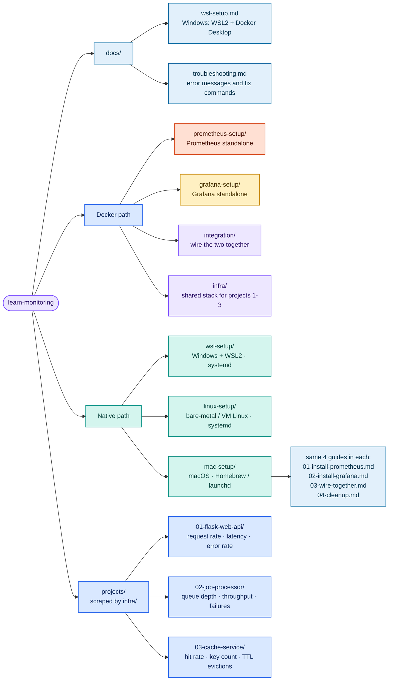
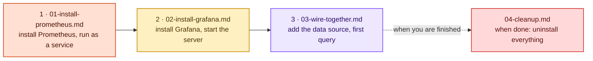

# learn-monitoring — Setup & Installation Lab (Prometheus + Grafana)

Everything you need to **install and wire up** Prometheus and Grafana locally, plus the three
Docker application projects that produce real metrics to look at. No cloud accounts, no
subscriptions — it all runs on your machine.

Two setup paths: **Docker** (quickest start) or **Native** (install the binaries as system
services — closer to production). Pick one and follow it consistently.

> **Scope:** this repo is the setup/installation track only. Monitoring theory
> (monitoring-fundamentals) and the native-only projects / ELK pillar are not included here.

---

## Repository structure



Every setup directory and project has the same shape: a `README.md` explaining it, numbered
guides or a `CONNECT.md` for the hands-on steps, and a `CLEANUP.md` to tear it back down.

---

## Choose your path

### Path A — Docker (recommended for beginners)

Prometheus and Grafana run in containers managed by `infra/`. Projects join a shared Docker
network so Prometheus can scrape them by container name.

**Prerequisites:** Docker Desktop installed. On Windows, complete `docs/wsl-setup.md` first.

```bash
docker run hello-world   # verify Docker works
docker compose version   # verify Compose v2
```

### Path B — Native (no Docker for Prometheus/Grafana)

Prometheus and Grafana run as system processes directly on your OS. All three directories end
up with Prometheus on 9090 and Grafana on 3000:

| Your machine | Setup directory | Service manager | Prometheus config path |
|---|---|---|---|
| Windows + WSL2 (Ubuntu) | `wsl-setup/` | systemd | `/etc/prometheus/prometheus.yml` |
| Bare-metal / VM Linux | `linux-setup/` | systemd | `/etc/prometheus/prometheus.yml` |
| macOS | `mac-setup/` | launchd (`brew services`) | `$(brew --prefix)/etc/prometheus.yml` |

```bash
# Linux / WSL2 — verify systemd is PID 1:
ps --no-headers -o comm 1     # expected: systemd

# macOS — verify Homebrew is installed:
brew --version
```

---

## Recommended order

### Docker path

```mermaid
flowchart LR
    S1["1 · docs/wsl-setup.md<br/>Windows only: WSL2 + Docker Desktop"]:::doc
    S2["2 · prometheus-setup/<br/>run Prometheus by hand, then with Compose"]:::prom
    S3["3 · grafana-setup/<br/>first login, manual data source"]:::graf
    S4["4 · integration/<br/>why container networking needs a shared network"]:::net
    S5["5 · infra/README.md<br/>start the shared monitoring stack"]:::net
    S6["6 · projects/01-flask-web-api/CONNECT.md<br/>HTTP metrics, first dashboard"]:::app
    S7["7 · projects/02-job-processor/CONNECT.md<br/>queue + async metrics, histograms"]:::app
    S8["8 · projects/03-cache-service/CONNECT.md<br/>hit ratio, gauges, TTL evictions"]:::app

    S1 --> S2 --> S3 --> S4 --> S5 --> S6 --> S7 --> S8

    classDef prom fill:#FFE0D3,stroke:#D64518,stroke-width:1.5px,color:#4A1405
    classDef graf fill:#FFF0C2,stroke:#C98A00,stroke-width:1.5px,color:#4A3300
    classDef app fill:#D9E8FF,stroke:#2563EB,stroke-width:1.5px,color:#0B2559
    classDef net fill:#EDE7FF,stroke:#7C4DFF,stroke-width:1.5px,color:#2A1065
    classDef doc fill:#E2F0FB,stroke:#0369A1,stroke-width:1.5px,color:#06314A
```



### Native path

Use the directory for your OS (`wsl-setup/`, `linux-setup/` or `mac-setup/`) — the file names
are identical:



Projects 1–3 are the Docker track — they run as containers scraped by `infra/`. With a native
Prometheus you point `prometheus.yml` at `localhost:<port>` instead (each native install guide
ships a commented example job showing the syntax).

---

## The three projects

| # | Project | Stack | Metrics it teaches |
|---|---|---|---|
| 1 | `projects/01-flask-web-api/` | Flask + `prometheus_client` | Counter, Histogram, Gauge — request rate, p95 latency, error rate |
| 2 | `projects/02-job-processor/` | Python + worker thread queue | Queue depth, throughput, job duration, failure rate |
| 3 | `projects/03-cache-service/` | Flask in-memory cache with TTL | Hit/miss ratio, key count, TTL evictions |

Each project directory contains:

- `README.md` — what it does, which metrics it exposes and **why each metric type was chosen**
- `CONNECT.md` — step-by-step: start it, confirm the scrape, build/import the dashboard
- `docker-compose.yml` — the project's own stack (joins the `monitoring` network)
- `app/` — the application source, `requirements.txt` and `Dockerfile`
- `dashboards/` — the Grafana dashboard JSON for that project
- `CLEANUP.md` — stop and remove everything it created

`infra/grafana/dashboards/` also provisions a combined **all-projects overview** dashboard
automatically when the shared stack starts.

---

## Ports used

| Service | Port |
|---|---|
| Prometheus | 9090 |
| Grafana | 3000 (login `admin` / `admin`) |
| Project 1 — Flask Web API | 8081 |
| Project 2 — Job Processor | 8082 |
| Project 3 — Cache Service | 8083 |

---

## When something breaks

`docs/troubleshooting.md` is organized by the exact error message you see — ports already in
use, containers not starting, `external network "monitoring" not found`, empty dashboards, YAML
errors, volume permissions, WSL2 path issues, and a full-reset procedure.
