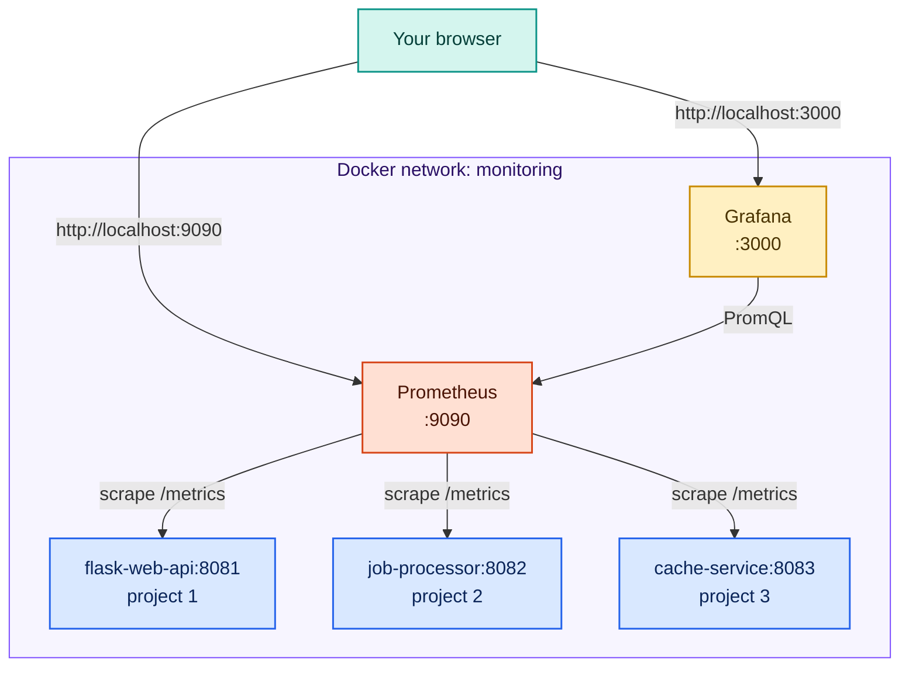

# infra/ — Shared Monitoring Infrastructure

This directory contains the **shared Prometheus and Grafana** that all projects connect to.
Start this once and leave it running while you work on the projects.

---

## What this runs



Prometheus and Grafana live on a Docker network called **`monitoring`**. Projects 1–3
join this network so Prometheus can scrape them by container name.

> **Scope:** this repo covers setup/installation plus Projects 1–3 (Docker). Native-only
> projects run as local Python processes scraped by the **native** Prometheus from
> `wsl-setup/` / `linux-setup/` / `mac-setup/`, not by this Docker instance.

---

## Start the infrastructure

> **Coming from `../integration/`?** That section runs its own `prometheus` and `grafana`
> containers, which use the **same names** as this stack. Docker won't let two containers
> share a name, so starting this one on top of it fails with
> `Conflict. The container name "/prometheus" is already in use`. Tear the integration
> stack down first:
> ```bash
> docker compose -f ../integration/docker-compose.yml down
> ```
> The `integration/` stack is a standalone teaching exercise — you don't keep it running
> alongside `infra/`. This `infra/` stack is the one the projects scrape against.

```bash
cd infra
docker compose up -d
```

**Expected output:**
```
[+] Running 5/5
 ✔ Network monitoring        Created
 ✔ Volume infra_promdata     Created
 ✔ Volume infra_grafdata     Created
 ✔ Container prometheus      Started
 ✔ Container grafana         Started
```

**Verify:**
```bash
docker compose ps
```

```
NAME         STATUS    PORTS
prometheus   running   0.0.0.0:9090->9090/tcp
grafana      running   0.0.0.0:3000->3000/tcp
```

Open:
- **http://localhost:9090** — Prometheus UI (run query `up` to confirm it works)
- **http://localhost:3000** — Grafana (login: `admin` / `admin`)

---

## Connect a project

Each project directory has a `CONNECT.md` with exact steps. The short version is:

1. **Start the project** from its directory: `docker compose up -d --build`
2. **Edit `infra/prometheus.yml`** — uncomment that project's job block
3. **Reload Prometheus** (no restart needed): `curl -X POST http://localhost:9090/-/reload`
4. **Verify** at `http://localhost:9090/targets` — the target should show `UP`

---

## Reload Prometheus config (after editing prometheus.yml)

The `--web.enable-lifecycle` flag lets you reload without restarting:

```bash
curl -X POST http://localhost:9090/-/reload
```

**Expected output:** HTTP 200 (empty body)

Prometheus logs will show:
```
msg="Completed loading of configuration file"
```

If you prefer a restart instead:
```bash
# From this directory:
docker compose restart prometheus
```

---

## Pre-loaded Grafana dashboard

A combined dashboard is provisioned automatically on first start:

**Dashboards → Projects → All Projects Overview**

It has a row for each project. Panels for projects that are not running show "No data"
until that project is started and connected.

---

## Files

| File | Purpose |
|------|---------|
| `docker-compose.yml` | Prometheus + Grafana; creates the `monitoring` network |
| `prometheus.yml` | Scrape config — uncomment project jobs to enable scraping |
| `grafana/provisioning/datasources/prometheus.yml` | Auto-registers Prometheus in Grafana |
| `grafana/provisioning/dashboards/dashboard.yml` | Dashboard provider config |
| `grafana/dashboards/all-projects-overview.json` | Combined dashboard (projects 1–3) |
| `grafana/dashboards/flask-web-api.json` | Project 1 standalone dashboard |
| `grafana/dashboards/job-processor.json` | Project 2 standalone dashboard |
| `grafana/dashboards/cache-service.json` | Project 3 standalone dashboard |

> Only the Projects 1–3 dashboards are provisioned here. Dashboards for any native project
> are imported manually into the native Grafana.

---

## Stop / reset

```bash
# Stop but keep data (dashboards, Prometheus history):
docker compose down

# Full reset — wipes all stored data:
docker compose down -v
```

> After `docker compose down -v`, the next `docker compose up -d` starts completely fresh.
> Any dashboards you created manually in Grafana will be lost (provisioned ones come back automatically).

---

## Ports

| Service    | Port | URL |
|------------|------|-----|
| Prometheus | 9090 | http://localhost:9090 |
| Grafana    | 3000 | http://localhost:3000 |
