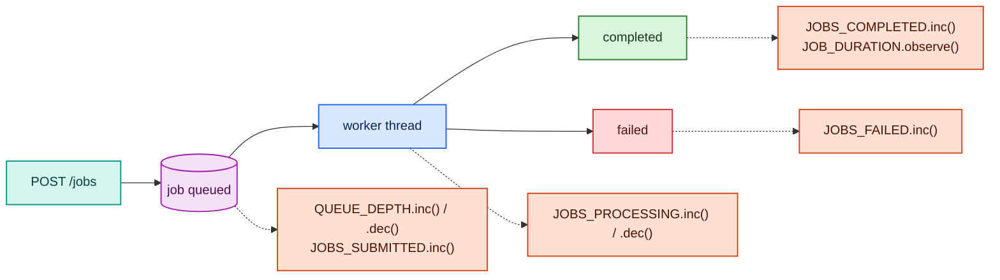

# Project 2 — Job Processor

A Python background job processor with a queue. Jobs are submitted over HTTP and
processed asynchronously by a worker thread. This project shows how to track
queue depth, throughput, and failure rates — metrics common to any async system.

---

## What it does



The worker picks one job at a time, sleeps for a random 0.5–5 seconds (simulating
real work), and fails 15% of jobs to give you error-rate data to look at.

---

## Routes

```
POST /jobs          → submit a job; returns {job_id, status: "queued"}
GET  /jobs/<id>     → check status: queued / processing / completed / failed
GET  /stats         → total counts by status
GET  /metrics       → Prometheus scrapes this
```

---

## Metrics produced

| Metric | Type | What it measures |
|--------|------|-----------------|
| `jobs_submitted_total` | Counter | Total jobs submitted |
| `jobs_completed_total` | Counter | Jobs finished successfully |
| `jobs_failed_total` | Counter | Jobs that hit the 15% failure |
| `job_duration_seconds` | Histogram | Processing time per job (0.5–5s) |
| `job_queue_depth` | Gauge | Jobs waiting to be picked up |
| `jobs_currently_processing` | Gauge | Jobs being processed right now |

---

## Quick start

```bash
# 1. Start shared infra
cd infra && docker compose up -d && cd ..

# 2. Start this project
cd projects/02-job-processor
docker compose up -d --build

# 3. Wire it into Prometheus (uncomment the job-processor block,
#    reload, and verify the target is UP) — full steps in CONNECT.md
#    Then submit some jobs so Prometheus has data to scrape:
for i in $(seq 1 10); do
  curl -s -X POST http://localhost:8082/jobs \
    -H "Content-Type: application/json" \
    -d "{\"payload\": \"task-$i\"}"
done

# 4. Connect to Prometheus + Grafana
# Follow CONNECT.md
```

> Submit jobs **after** the scrape job is uncommented and Prometheus is reloaded (CONNECT.md
> Steps 2–3) — jobs submitted before that won't be captured.

---

## Files

| File | Purpose |
|------|---------|
| `app/app.py` | Flask app + background worker thread + metrics |
| `app/requirements.txt` | Python dependencies |
| `app/Dockerfile` | Container image |
| `docker-compose.yml` | Runs the app on the `monitoring` network |
| `CONNECT.md` | Step-by-step integration guide |
| `dashboards/job-processor.json` | Grafana dashboard for this project |

---

## Port

| Service | Port | URL |
|---------|------|-----|
| Job Processor API | 8082 | http://localhost:8082 |
| Metrics | 8082 | http://localhost:8082/metrics |
